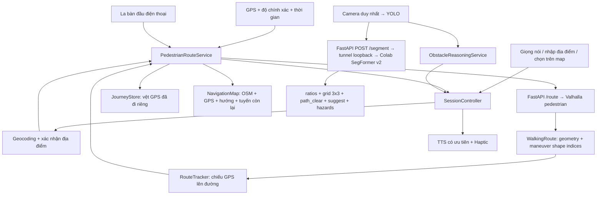

# Kiến trúc dẫn đường đi bộ

Cập nhật 14/10/2026. Trạng thái triển khai và hướng dẫn bàn giao: [HANDOFF_PEDESTRIAN.md](HANDOFF_PEDESTRIAN.md).

## Luồng dữ liệu

## Các ranh giới

- `LocationSource`: GPS thật hoặc nguồn fake trong test; kiểm tra quyền, dịch vụ vị trí, stream và fix hiện tại.
- `CompassService`: hướng đầu thiết bị và lọc độ chính xác; navigation làm mượt góc và hết hạn dữ liệu cũ.
- `WalkingRoute`: geometry `[lat,lng]`, khoảng cách tích lũy và các maneuver gắn với chỉ số shape. Client từ chối route ô tô hoặc API cũ thiếu geometry.
- `RouteTracker`: phép chiếu trên segment và cửa sổ tiến độ, khoảng cách ngang tuyến, điểm nhìn trước và cắt phần đường còn lại.
- `PedestrianRouteService`: state machine `locating/idle/planning/navigating/offRoute/poorGps/arrived/error/paused`; định kỳ tính lại đường tới đích từ GPS mới; kiểm soát response cũ bằng generation.
- `JourneyStore`: vệt thực tế, khoảng cách đã đi, ranh giới đoạn và đích còn dở; không ghi đè vệt khi thay tuyến.
- `SessionController`: điều phối voice, route và perception; route không phụ thuộc camera hoạt động. TTS cảnh báo có ưu tiên hơn chỉ dẫn tuyến.
- `NavigationMap`: nền OSM, vị trí thật, vòng sai số, mũi tên đầu điện thoại, hướng lối đi, vệt đã đi, tuyến còn lại và marker đích.

## Tiến độ thích ứng

Maneuver vẫn cần tồn tại để biết nơi rẽ, nhưng tiến độ không dựa vào một bán kính waypoint cố định. GPS được chiếu lên đường; maneuver nào đã qua được xác định bằng khoảng cách dọc polyline. Khoảng cách hướng dẫn cũng tính dọc đường, không lấy đường chim bay tới điểm rẽ.

Ngưỡng vẫn cần để xử lý độ không chắc chắn: lọc GPS, xác nhận lệch tuyến và đến đích. Các ngưỡng này gắn với accuracy, tốc độ hoặc số fix liên tiếp, không đóng vai trò cơ chế chuyển waypoint.

Tuyến được kiểm tra mỗi 5 giây, cập nhật sau 30 giây nếu đã di chuyển >=5 m, hoặc sớm khi lệch tuyến được xác nhận. Chỉ cập nhật đường phía trước, không thay lịch sử đã đi. Không gọi đồng thời các refresh cho cùng đích; thay đích hủy hiệu lực kết quả cũ.

## Hợp đồng server v2

- `GET /health`: health, routing profile, API version.
- `POST /detect`: YOLO như trước.
- `POST /segment`: phân vùng tùy chọn, chạy song song YOLO; multipart `image`, query `diagnostics=false`, `mask=none|png|rle` (sai mask → 422). Bật bằng `COLAB_SEG_URL` HTTP loopback; rỗng là tắt, không ảnh hưởng `/detect` hoặc `/health`.
- `GET /geocode?q=&near_lat=&near_lng=`: địa điểm ưu tiên vùng hiện tại, chờ người dùng xác nhận.
- `GET /reverse?lat=&lng=`: địa chỉ gần vị trí theo yêu cầu.
- `GET /route?from_lat=&from_lng=&to_lat=&to_lng=`: Valhalla pedestrian, geometry và maneuvers đầy đủ.

`VALHALLA_URL` cấu hình server; `AI_SERVER_URL` cấu hình Flutter, ưu tiên dart-define rồi `.env`. Chạy Nominatim proxy một worker để giữ rate limit trong process.

`/segment` trả `success=true`, `image_width`/`image_height` của **ảnh vừa tải lên sau EXIF transpose**, `classes` theo thứ tự `other floor sidewalk road crosswalk stairs curb terrain obstacle`, `ratios` (tên → tỷ lệ), `grid` 3x3 (hàng 0 xa/trên, hàng 2 gần/dưới; cột trái/giữa/phải; mỗi ô có `walkable`, `caution`, `blocked` trong [0,1] và `dominant`), `path_clear` bool, `suggest` (`straight|left|right|stop`), `hazards` (tập con của `stairs_ahead`, `curb_ahead`, `road_ahead`, `crosswalk_ahead`, `obstacle_ahead`) và `cached` bool. Khi yêu cầu mask, chuyển nguyên `mask_w`, `mask_h` và `mask_png_b64` hoặc `mask_rle`; mask thuộc ảnh gửi worker đã thu nhỏ cạnh dài tối đa 640. Diagnostics chỉ khi yêu cầu: `source=colab`, `model`, `runtime` dạng `cuda/fp16`, `inference_ms` đo toàn lời gọi server, thêm `cache_age_ms` khi cached. Chi tiết PNG class-ID/RLE đa lớp xem [README server](../ai_server/README.md).

Giới hạn upload, EXIF và lỗi 400/413 dùng chung với `/detect`. Lỗi 503 có `detail` cố định `Segmentation worker unavailable.` (tắt/chưa sẵn sàng/cooldown/worker 503) hoặc `Segmentation worker busy.` (đang xử lý/chưa đủ khoảng cách và thiếu cache tươi/pool timeout); lỗi bất ngờ là 500 `Segmentation failed.`. `SegmentationWorker` có một HTTP client keep-alive chung cho health mỗi 4 giây và inference, timeout 3 giây (connect 0,3; pool 0,1), expiry 30 giây. Khóa in-flight không chờ; `SEG_MIN_INTERVAL_MS=500` giới hạn khoảng cách giữa các lần gửi, cache riêng từng mask mode chỉ dùng khi tuổi <1,5 giây, xóa khi worker mất sẵn sàng. Worker 503 cooldown 5 giây; lỗi HTTP/timeout/JSON/hợp đồng cooldown 10 giây. Không lưu ảnh ra đĩa, không cache theo nội dung ảnh, không có segmentation fallback CPU.

Chỉ vận hành **v2 `runs/segformer_b5_v2/best`, tuyệt đối không v1**; `/health` worker chỉ có tên thư mục `best`, cần xác nhận đường dẫn v2 đầy đủ trong log Colab. `stairs` yếu (IoU khoảng 0,18), **không dùng để cảnh báo cầu thang** hoặc kết luận không có cầu thang khi thiếu hazard. Curb/crosswalk chỉ là gợi ý. Flutter gọi `/segment` sau cờ `WALKABLE_SEG` (mặc định tắt) qua `SegmentationService`, dùng lại frame của YOLO, không chờ, mỗi ~1,8 giây; `WalkableGuidance` (lớp thuần) áp hysteresis/cooldown và bỏ qua `stairs_ahead`. Lỗi phân vùng chỉ làm tắt phân vùng, không gọi luồng mất nhận diện YOLO. Chưa kiểm thử thực địa và chưa đo độ trễ đầu-cuối. Xem [handoff phân vùng](HANDOFF_WALKABLE_SEG.md).

## Lớp trợ lý OpenAI bổ sung

`SessionController → AssistantController → AiAssistantService → /assistant/chat → Responses API` là luồng riêng, không tham gia vòng quyết định GPS/YOLO. Trợ lý đọc snapshot, nhận ảnh hiện tại khi user yêu cầu, dùng tools truy vấn/tìm địa điểm/tạo proposal. Proposal chỉ gọi callback dẫn đường sau xác nhận của người dùng và kiểm tra context lại. AI TTS có ưu tiên thấp nhất.

Backend giữ key trong `ai_server/.env`; Flutter giữ `.env` URL hiện tại và token thiết bị runtime trong secure storage. Endpoint assistant dùng HTTPS, ghép nối/HMAC, rate limit, budget SQLite và bounded tool loop. Chủ động theo sự kiện, opt-in và cooldown; không gửi ảnh/model request mỗi frame. Xem [handoff OpenAI](HANDOFF_OPENAI_ASSISTANT.md) cho giao thức, cấu hình, kiểm thử và giới hạn.

Nút nói chính và text hội thoại cùng gọi `SessionController.handleUtterance → VoiceCommand.parse`: mẫu dẫn đường gốc chạy local trước, phần còn lại đi qua assistant. `AssistantPanel` hiển thị câu trả lời và xác nhận proposal trực tiếp trên màn bản đồ. Ghép nối có nhập/dán/QR, giữ input khi lỗi. QR chỉ chứa enrollment code và không thay URL backend; camera được nhường tạm cho scanner rồi khôi phục YOLO, còn GPS/TTS dẫn đường vẫn chạy. Chi tiết giao thức và vòng đời camera nằm trong handoff OpenAI.

## Giới hạn được giữ rõ

Bản demo giả định người dùng cầm điện thoại nghiêng (như khi đọc màn hình), đầu máy hướng về phía trước: hướng la bàn là hướng của cạnh trên điện thoại, nên máy dựng đứng hoàn toàn sẽ cho hướng sai (flutter_compass trên Android không cung cấp hướng theo trục camera). Chỉ dẫn ưu tiên la bàn còn mới; GPS course là dự phòng khi đang đi với sai số ≤10 m. Bốn mức chỉ hướng có hysteresis 8° để tránh đổi câu liên tục ở ranh giới. GPS demo chấp nhận sai số ≤50 m và fix không quá 30 giây; khi GPS yếu mà đã có tuyến, tiếp tục chỉ hướng từ vị trí khớp tuyến gần nhất và cảnh báo một lần mỗi đợt. Map matching cục bộ không xác định được bên vỉa hè hoặc tầng trong nhà. Đi bộ theo dữ liệu OSM chưa chứng minh tuyến an toàn/tiếp cận cho người khiếm thị. Camera YOLO dùng bbox heuristic; backend có phân vùng walkable-area tùy chọn qua Colab v2, chưa có depth hoặc tránh/sang đường tự động. Phân vùng là gợi ý trong không gian ảnh; stairs yếu (IoU khoảng 0,18) không dùng để cảnh báo cầu thang, curb/crosswalk chỉ là gợi ý. App chưa dẫn đường khi khóa màn hình. Các bước xác minh và tiếp tục được liệt kê trong handoff.
