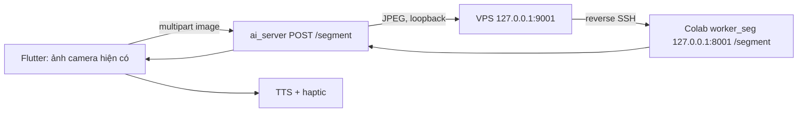

# Bàn giao: thêm phân vùng vùng đi được (walkable-seg) vào HTTM-clean

> Bản sao từ `E:/thieuh/FolderCode/walkable-seg/docs/HANDOFF_WALKABLE_SEG.md` (commit c54d1a8); link trỏ về repo walkable-seg. Ảnh minh họa model: `E:/thieuh/FolderCode/walkable-seg/docs/img/v2_overlays.jpg`.

> Soạn ngày 2026-11-20 trong repo `walkable-seg`, để đưa cho một phiên Claude sẽ sửa code `E:/thieuh/FolderCode/Flutter/HTTM-clean`.
> Quy ước: **[Thực tế]** = đã đối chiếu với code hoặc đã đo (nguồn: [RESULTS.md](E:/thieuh/FolderCode/walkable-seg/docs/RESULTS.md)); **[Đề xuất]** = thiết kế đề nghị, người sửa được phép đổi. Số dòng của HTTM-clean đo ở working tree ngày soạn (có thay đổi chưa commit ở `ai_server/main.py`, `detector.py`, `colab_inference.py`), nên đọc lại file trước khi sửa.

> [!CAUTION]
> **Đọc trước khi làm bất cứ gì [Thực tế, theo docs/RESULTS.md]**
> - **Chỉ dùng `runs/segformer_b5_v2/best`.** **Không dùng v1** (`runs/segformer_b5_v1`): v1 học nhãn SANPO bị đảo (mask gốc 0 = đi được, 1 = không đi được; SPEC cũ ghi ngược), nên trên ảnh camera đầu/ngực nó gán trời và cây là "crosswalk" và báo `path_clear=true`. SANPO walkable IoU của v1 = 0,007 (v2 best = 0,946). v1 **không an toàn** cho người dùng.
> - `GET /health` chỉ trả `model` = **tên thư mục** checkpoint (vd `"best"`), nên **không phân biệt được v1 với v2**. Notebook worker dùng v2 `best`, thiếu thì lùi sang v2 `final`, **không bao giờ tự lùi về v1** (có test `test_worker_never_falls_back_to_v1`). Người vận hành vẫn nên xác nhận dòng `Model: .../runs/segformer_b5_v2/...` trong log notebook.
> - **Cầu thang (`stairs`) yếu**: IoU 0,176 (pooled, v2 best), dao động 0,15–0,25 suốt quá trình train. **Không dựa vào `hazards: stairs_ahead` (hoặc việc thiếu nó) để cảnh báo cầu thang**; curb (0,494) và crosswalk (0,628) cũng chỉ là gợi ý, không phải cảnh báo an toàn. Các hàng cảnh báo trong §5.3 phải được hiểu theo hướng này.

## 1. Tổng quan

- Model: SegFormer (mặc định b5) phân vùng ảnh thành **9 lớp**, chạy **chỉ trên Colab** (train trên A100; worker phục vụ chạy trên T4, fp16), không xuất ra điện thoại. Đặc tả: [SPEC.md](E:/thieuh/FolderCode/walkable-seg/SPEC.md). Code worker: [worker_seg.py](E:/thieuh/FolderCode/walkable-seg/worker_seg.py), [walkseg_infer.py](E:/thieuh/FolderCode/walkable-seg/walkseg_infer.py), [walkseg_common.py](E:/thieuh/FolderCode/walkable-seg/walkseg_common.py).
- Worker nhận một ảnh JPEG, trả về **bản tóm tắt điều hướng đã tính sẵn** (tỉ lệ lớp, lưới 3x3, `path_clear`, `suggest`, `hazards`) và tùy chọn mask. App không cần tự xử lý mask để ra quyết định.
- Lớp (`CLASSES`, walkseg_common.py:9): `other(0) floor(1) sidewalk(2) road(3) crosswalk(4) stairs(5) curb(6) terrain(7) obstacle(8)`.
  Nhóm: WALKABLE={1,2,4,7}, CAUTION={3,5,6}, BLOCKED={0,8} (walkseg_common.py:13-15). Chú ý: `stairs`, `curb`, `road` thuộc CAUTION, **không** phải walkable.
- Đường đi dữ liệu mới (song song với YOLO, không thay thế):



- Hiện tại HTTM-clean **chưa có** walkable-area: docs/ARCHITECTURE.md:65 ("Camera dùng bbox heuristic, chưa có depth, walkable-area ..."). Sau khi làm xong cần sửa câu này.

## 2. Hợp đồng HTTP của worker [Thực tế, theo code worker_seg.py]

Chạy: `uvicorn worker_seg:app --host 127.0.0.1 --port <cổng>` (SPEC ghi 8000; xem §3 về cổng). Env của worker: `WALKSEG_MODEL_DIR` (thư mục checkpoint, vd `best/` hoặc `final/`), `WALKSEG_FP16` (mặc định true; chỉ có tác dụng trên CUDA). Import module không nạp trọng số; model nạp trong lifespan (worker_seg.py:49-55, 128-131). Không có xác thực.

### 2.1 `GET /health`
Luôn trả **200** kể cả khi model chưa nạp (worker_seg.py:57-66, 135-137):
```json
{"status":"ok","ready":true,"model":"<tên thư mục checkpoint>|null",
 "runtime":{"device":"cuda","fp16":true},
 "task":"segmentation","classes":["other","floor","sidewalk","road","crosswalk","stairs","curb","terrain","obstacle"]}
```
- `ready=false` khi `WALKSEG_MODEL_DIR` trống hoặc checkpoint lỗi (log exception, `/segment` trả 503).
- **Khác worker YOLO**: không có `names` (dict id->tên) và không có `sha256`; thay bằng `classes` (list). Vì vậy `RemoteWorker.check_health` hiện có (colab_inference.py:146 đọc `payload["names"]`) **không dùng lại nguyên xi** được; và `local-tools/switch-colab-model.ps1:42,95,115` (dựa vào `sha256`) **không áp dụng** cho worker này.

### 2.2 `POST /segment`
- **Body**: bytes ảnh thô (không multipart). SPEC ghi `Content-Type: image/jpeg`, nhưng **code không kiểm tra Content-Type**; Pillow tự nhận định dạng. Giới hạn body 20 MiB (`MAX_BODY_BYTES`), ảnh tối đa 40 triệu pixel (worker_seg.py:33-34).
- **Query** (worker_seg.py:139-146):
  - `mask` ∈ `png` | `rle` | `none`, mặc định `png`.
  - `max_side` số nguyên ≥ 1, mặc định `640`: cạnh dài tối đa của **mask trả về** (chỉ thu nhỏ, NEAREST, không phóng to). Không ảnh hưởng tới tóm tắt (tính trên nhãn độ phân giải ảnh gửi lên).
  - Giá trị sai (`mask` ngoài 3 giá trị, `max_side` không phải số nguyên hoặc <1) -> **400**.
- **Ảnh**: tự `exif_transpose` rồi convert RGB (worker_seg.py:76-79), nên `w`,`h` trả về là kích thước **sau khi xoay theo EXIF**. Model resize cạnh ngắn về `short_side` (mặc định 640, hoặc `short_side` trong `walkseg_meta.json`) bằng PIL BILINEAR (walkseg_infer.py:75-78) — **có thể phóng to** ảnh nhỏ. Từ 4 MP trở lên dự đoán ở độ phân giải suy luận rồi NEAREST về kích thước gốc (walkseg_infer.py:19, 82-91).
- **JSON trả về (200)** — đúng thứ tự khóa trong code (worker_seg.py:96-115, walkseg_infer.py:151-157):
```json
{
  "w": 640, "h": 480,
  "classes": ["other","floor","sidewalk","road","crosswalk","stairs","curb","terrain","obstacle"],
  "ratios": {"other":0.1, "floor":0.0, "...":0.0, "obstacle":0.02},
  "grid": [ [ {"walkable":0.0,"caution":0.0,"blocked":1.0,"dominant":"other"}, {..}, {..} ],
            [ {..}, {..}, {..} ],
            [ {..}, {..}, {..} ] ],
  "path_clear": true,
  "suggest": "straight",
  "hazards": ["stairs_ahead"],
  "mask_w": 640, "mask_h": 480,
  "mask_png_b64": "<base64 PNG>",
  "latency_ms": 123.4
}
```
  - `mask_w`, `mask_h` xuất hiện khi `mask != none`; kèm `mask_png_b64` nếu `mask=png`, hoặc `mask_rle` nếu `mask=rle`. Với `mask=none` không có các khóa mask.
  - `mask_png_b64`: PNG 8-bit (mode L), mỗi pixel là **ID lớp 0..8** (không phải ảnh tô màu).
  - `mask_rle` = `{"size":[mask_h,mask_w], "order":"C", "values":[...], "counts":[...]}`: cặp (value,count) lặp ID lớp theo thứ tự hàng (trái->phải, trên->dưới); count dương, tổng = h*w. Đây là RLE đa lớp, **không** phải COCO RLE.
  - `latency_ms`: tổng thời gian trong worker (gồm chờ lock, giải mã, suy luận, mã hóa mask), không gồm tunnel.
- **Ngữ nghĩa các trường tóm tắt** (walkseg_infer.py:124-157). Mọi thứ là heuristic **trong không gian ảnh**, không phải khoảng cách mét:
  - `grid[hàng][cột]`: hàng 0 = **xa** (trên ảnh), hàng 2 = **gần** (đáy ảnh); cột 0/1/2 = trái/giữa/phải của ảnh. Mỗi ô: `walkable`/`caution`/`blocked` (tổng tỉ lệ nhóm, 0..1) và `dominant` (tên lớp chiếm nhiều nhất, hòa -> ID nhỏ nhất).
  - `ratios`: tỉ lệ từng lớp toàn ảnh.
  - `path_clear` = `grid[2][1].walkable >= 0.6 && grid[2][1].blocked <= 0.15` (ô giữa-gần).
  - `suggest` ∈ `"straight"|"left"|"right"|"stop"`: điểm mỗi cột = tỉ lệ walkable của vùng (hàng giữa + hàng gần); chọn cột điểm cao nhất, hòa ưu tiên straight, left, right; nếu điểm cao nhất < 0.6 -> `"stop"`.
  - `hazards`: cột giữa, hai hàng dưới, lớp chiếm **>= 0.08**; thứ tự cố định: `stairs_ahead`, `curb_ahead`, `road_ahead`, `crosswalk_ahead`, `obstacle_ahead`. Có thể rỗng hoặc nhiều giá trị.
  - Hệ quả cần biết: cảnh có cầu thang/vỉa lòng đường chiếm phần lớn sẽ cho `suggest="stop"` vì các lớp đó không tính walkable.
- **Mã lỗi** (worker_seg.py:68-95, 139-162):

| Mã | Khi nào |
|----|---------|
| 400 | `mask`/`max_side` sai; `Content-Length` không hợp lệ/âm; ảnh không giải mã được, body rỗng, hoặc >40 MP (`detail`: "Invalid image or image exceeds 40 million pixels") |
| 413 | body >20 MiB (kiểm tra cả header lẫn lúc stream) |
| 503 | model chưa sẵn sàng ("Segmentation model is not ready"); hoặc CUDA hết bộ nhớ ("Segmentation CUDA out of memory", đã `empty_cache`) |
| 500 | lỗi không lường trước (không có handler riêng) |
  Thứ tự kiểm tra trong `segment()`: 413 -> 503 (model) -> 400 (ảnh). Nên body rỗng khi model chưa sẵn sàng vẫn ra 503.
- **Đồng thời**: một `Lock` tuần tự hóa GPU; yêu cầu thứ hai **đứng chờ**, **không** bị trả 503 "bận". Khác worker YOLO (colab_inference.py:173-174 coi 503 là "bận"). Hệ quả: nếu client gửi dồn, yêu cầu xếp hàng và gặp timeout phía client -> ai_server phải tự giới hạn một yêu cầu bay cùng lúc (§4.3).
- Có `create_router()`/`create_app()` để gộp vào app khác (worker_seg.py:118-171), nhưng gộp vào worker YOLO sẽ **đụng `/health`** (hai hợp đồng khác nhau). Khuyến nghị chạy **tiến trình riêng, cổng riêng** (§3).

## 3. Kết nối Colab -> VPS

**[Thực tế] cách đang chạy với YOLO** (code không chứa lệnh tunnel; chỉ thấy phía VPS):
- Worker YOLO trên Colab: `uvicorn worker:app --host 127.0.0.1 --port 8000` (local-tools/switch-colab-model.ps1:82-89).
- Tunnel đưa nó về VPS tại `127.0.0.1:9000`; bật/tắt bằng `COLAB_WORKER_URL=http://127.0.0.1:9000` / rỗng (local-tools/set-colab.ps1:11-20, kiểm tra tại :26).
- ai_server trên VPS nghe cổng 8001 (`HTTM_PORT` mặc định 8001, local-tools/_lib.ps1:137) — **9001 không đụng** cổng này, nhưng nhớ đây là hai thứ khác nhau.
- Lệnh tunnel và `/content/worker.py` của YOLO nằm trong notebook Drive `HTTM_yolo11m_train_worker.ipynb` (không có trong repo) — **phải mở notebook đó để lấy đúng thông số tunnel YOLO**.

**[Thực tế] seg worker (đã chạy qua tunnel, theo colab/make_notebooks.py, notebook `walkseg_worker`):**
- Notebook: Drive `MyDrive/HTTM_WalkSeg/walkseg_worker.ipynb`, **sinh từ [colab/make_notebooks.py](E:/thieuh/FolderCode/walkable-seg/colab/make_notebooks.py)** (sửa generator rồi sinh lại, đừng sửa tay file .ipynb). Chạy trên **runtime T4 riêng** (RAM tiêu chuẩn, không High-RAM), tách khỏi runtime của worker YOLO. Mặc định nạp `runs/segformer_b5_v2/best`, ghi code worker vào kernel, fp16.
- Worker: `uvicorn worker_seg:app --host 127.0.0.1 --port 8001` trong tiến trình con của notebook (cổng 8001 trên **Colab**; không liên quan cổng 8001 của ai_server trên VPS). Vì khác runtime với YOLO (8000) nên không đụng cổng; lệnh `pkill -f 'uvicorn worker:app'` của switch-colab-model.ps1:82 cũng không khớp `worker_seg:app`.
- Tunnel: **reverse SSH `127.0.0.1:9001` (VPS) -> `127.0.0.1:8001` (Colab)**, chỉ bind loopback, ô "SSH 2/2" của notebook, tự nối lại trong một thread, log `ssh_seg.log` trên Drive. Host key VPS được pin trong notebook; user/host nằm ở ô đó (không chép lại ở đây).
- Khóa SSH **tạm mỗi phiên** (ô "SSH 1/2"): key ed25519 sinh ở `/content` (không lưu Drive), comment `httm-colab-seg-<ngày UTC>`. Notebook in ra một dòng `authorized_keys` với tùy chọn `restrict`, `permitlisten="127.0.0.1:9001"`, `command="/bin/false"`, chặn local forwarding (`permitopen` trỏ host vô hiệu) và `expiry-time` = **24 giờ** kể từ lúc sinh. **Người vận hành** thêm dòng đó vào `~/.ssh/authorized_keys` trên VPS **trước** khi chạy ô SSH 2/2, và **xóa dòng đó khi xong phiên** (hết hạn 24 giờ chỉ là lưới an toàn).
- Dừng: interrupt ô cuối của notebook sẽ dọn cả uvicorn lẫn tunnel; ngắt runtime Colab để khỏi tốn compute units. Kiểm tra từ VPS: `curl -s -m 4 http://127.0.0.1:9001/health` -> `ready:true`.
- Phiên Colab có giới hạn thời gian và có thể bị thu hồi; mỗi phiên mới phải lặp lại việc thêm key. App phải sống tốt khi seg tắt.

**[Đề xuất] phía ai_server cho segmentation:**
- Env mới trên VPS: **`COLAB_SEG_URL`** (vd `http://127.0.0.1:9001`; rỗng = tắt). Chỉ chấp nhận `http` + loopback, giống `build_remote_worker` (colab_inference.py:202-213) vì worker không có xác thực.
- Đọc env bằng `detector_setting()` (detector.py:100-111: process env trước, rồi `ai_server/.env`).
- Thêm `COLAB_SEG_URL` vào whitelist khóa của `local-tools/_lib.ps1:169` (hiện chỉ `YOLO_MODEL|YOLO_CONFIDENCE|YOLO_IOU|YOLO_IMGSZ|COLAB_WORKER_URL`, khóa lạ bị từ chối `exit 30`), và thêm hành động tương tự `set-colab.ps1` (sửa hoặc tạo `set-colab-seg.ps1`, hiện :14 và :19 chỉ đặt `COLAB_WORKER_URL`).
- Nên ghi vào `ai_server/.env.example` (hiện chưa có dòng `COLAB_*`).

## 4. Việc cần làm ở `ai_server`

### 4.1 Client mới — `ai_server/colab_segmentation.py` [Đề xuất]
Theo khuôn `colab_inference.py`:
- Dùng lại `encode_frame`, `MAX_SIDE`, `JPEG_QUALITY`, `LOOPBACK_HOSTS` (colab_inference.py:24-29, 46-55) bằng cách import (hoặc tách phần chung ra module nhỏ); không sao chép.
- Lớp `SegmentationWorker` có `httpx.Client(base_url, timeout, trust_env=False, limits=...)`, luồng nền `/health` mỗi `HEALTH_INTERVAL_SECONDS` (4 s), `ready`, `start()/stop()` — như `RemoteWorker` (colab_inference.py:98-199).
- Kiểm tra health riêng: `status=="ok"`, `ready is True`, `task=="segmentation"`, `classes` đúng bằng 9 tên kỳ vọng theo đúng thứ tự (đặt hằng `EXPECTED_CLASSES` trong ai_server; **không** import từ repo walkable-seg). Lệch -> coi như không sẵn sàng.
- `segment(image, mask="none") -> SegmentationResult | None`: `encode_frame` -> `POST /segment?mask=none` với `content=body`, header `Content-Type: image/jpeg` -> kiểm tra JSON: `(w,h) == sent_size` (như colab_inference.py:69), `ratios`/`grid` (3x3, mỗi ô có đủ 4 khóa, tỉ lệ hữu hạn trong [0,1]), `suggest` thuộc 4 giá trị, `hazards` là tập con của 5 tên, `path_clear` bool. Sai -> `ValueError`.
- Xử lý lỗi (khác YOLO vì **không có local fallback**):
  - `503` từ worker (model chưa sẵn sàng hoặc CUDA OOM): đánh dấu không sẵn sàng + cooldown ngắn (vd 5 s), trả lỗi lên route -> 503.
  - `httpx.PoolTimeout`: trả "bận" (không hạ trạng thái ready).
  - Lỗi HTTP/timeout/JSON/`ValueError`: `_set_unavailable(..., FAILURE_COOLDOWN_SECONDS)` (10 s) như colab_inference.py:177-181.
- Factory `build_segmentation_worker(url)` -> `None` nếu url rỗng; log lỗi và trả `None` nếu không phải `http` loopback.
- **Một `httpx.Client` dùng lại kết nối là bắt buộc** [Thực tế, đo trong RESULTS.md, T4 fp16, `mask=none`, JPEG 58 KB]: VPS -> tunnel -> worker với kết nối giữ sống cho **p50 ~183 ms (p95 198 ms)**, `mask=png` p50 196 ms (p95 215 ms); worker tự báo ~103 ms. Mỗi **kết nối TCP mới** qua tunnel tốn thêm **~0,5-1 s** (RTT VPS↔Colab ~257 ms; ở một lần đo khác keep-alive p50 lên 390-620 ms, nên độ trễ dao động theo phiên Colab). Vì vậy: một client duy nhất tạo ở lifecycle của `SegmentationWorker` (không tạo client/kết nối mới mỗi request), dùng chung cho `/health` và `/segment`, và đặt `limits=httpx.Limits(keepalive_expiry=...)` đủ dài (vd 30 s; mặc định httpx là 5 s, sát chu kỳ health 4 s) [Đề xuất].
- **Timeout** [Đề xuất]: `REQUEST_TIMEOUT` hiện `httpx.Timeout(2.0, connect=0.3, pool=0.1)` (colab_inference.py:28). Đặt riêng cho seg, **khởi điểm giữ `Timeout(3.0, connect=0.3, pool=0.1)`**. Lý do: (a) tổng 3,0 s lớn hơn nhiều so với p95 ~200 ms khi giữ kết nối, và vẫn chứa được yêu cầu đầu tiên sau khi kết nối mới (~0,2 s + 0,5-1 s) hoặc đợt chậm 390-620 ms; (b) nhỏ hơn deadline phía Flutter (hiện `AiConfig.detectTimeout`=4 s, ai_config.dart:75; main.py:40 cũng nhắc "4 s /detect deadline"); (c) `connect=0.3` và `pool=0.1` giữ như YOLO vì đích là loopback VPS và chỉ một yêu cầu bay cùng lúc (§4.3). **Chưa kiểm chứng**: `connect=0.3` có đủ khi tunnel vừa nối lại hay không, và độ trễ đầu-cuối Flutter (§8: chưa đo); nếu thấy `ConnectTimeout` thường xuyên thì tăng `connect` rồi chốt lại sau khi có số đo thực địa.
- Giữ separation of concerns: **không nhét** vào `YoloObstacleDetector` (detector.py:155). Tạo đối tượng ở `main.py` và truyền bằng constructor/tham số, đừng thêm global ẩn trong module khác.

### 4.2 Route `POST /segment` trong `ai_server/main.py` [Đề xuất]
- Đặt ngay sau `/detect` (main.py:84-150, trước `/geocode` ở :153).
- **Nhận ảnh giống `/detect`**: multipart field `image` (`UploadFile`), vì Flutter đang gửi kiểu đó (ai_detection_service.dart:79-90). Logic đọc/kiểm tra ảnh ở main.py:86-126 (giới hạn `DETECT_MAX_BYTES` 5 MB, `DETECT_MAX_PIXELS` 12 MP tại :28-30, exif_transpose tại :114, 413/400) nên **tách thành hàm dùng chung** (vd `read_upload_image`) thay vì dán lại; `test_detect_endpoint.py` phải giữ nguyên xanh.
- Gọi worker trong `run_in_threadpool` (như main.py:131), đo `inference_ms` toàn bộ.
- Tham số: `diagnostics: bool = False` (như /detect), `mask: Literal["none","png","rle"] = "none"` (app thường không cần mask; `png` cho debug). Với `png/rle` chuyển tiếp `mask_w`, `mask_h`, `mask_png_b64`/`mask_rle` nguyên văn.
- Response (đề xuất, cùng phong cách /detect):
```json
{"success": true, "image_width": 640, "image_height": 480,
 "ratios": {...}, "grid": [[{...}]], "path_clear": true, "suggest": "straight", "hazards": [],
 "classes": [...],
 "diagnostics": {"source":"colab","model":"<tên>","runtime":"cuda/fp16","inference_ms":123.4}}
```
  `image_width/height` là kích thước ảnh **gốc** người dùng gửi lên (như /detect), còn `grid`/`ratios` không phụ thuộc kích thước. Nếu trả mask thì ghi rõ mask ở hệ tọa độ ảnh đã thu nhỏ (`mask_w`,`mask_h`).
- Mã lỗi: 413/400 như `/detect`; **503 khi worker tắt** (`COLAB_SEG_URL` rỗng, `ready=False`, đang cooldown, hoặc worker trả 503) với `detail` tiếng Anh/cố định, ví dụ `"Segmentation worker unavailable."`; 503 riêng cho "đang bận" với `detail` khác (xem §4.3) để client phân biệt khi cần; 500 `"Segmentation failed."` cho lỗi bất ngờ (log `logger.exception`, như main.py:132-134). **Không có fallback cục bộ** trên VPS (model b5 quá nặng cho CPU; SPEC §1 mục tiêu "chỉ chạy trên Colab").
- Lifespan (main.py:38-46): thêm `start()` khi khởi động và `stop()` khi tắt cho worker seg, cạnh `detector.start_remote()`/`stop_remote()` (:44, :46). Tạo đối tượng cạnh `detector = YoloObstacleDetector()` (main.py:35).
- `/health` của ai_server (main.py:79-81) hiện trả dict chuỗi `{"status","routing_profile","api_version"}`; Flutter chỉ kiểm tra `status=="ok"` (ai_detection_service.dart:44-55). Nếu thêm trường báo seg sẵn sàng (vd `"segmentation": "ready"|"off"`) phải chỉ thêm khóa mới, không đổi khóa cũ; cân nhắc nâng `api_version` hay không. Lưu ý kiểu trả về khai báo `dict[str, str]`.
- Cần kiểm tra `AssistantBoundary` (main.py:64) không chặn `/segment` (chưa đọc kỹ middleware này — viết test gọi `/segment` qua `TestClient`).

### 4.3 Cache / throttle [Đề xuất]
- **Một yêu cầu bay tới worker tại một thời điểm** (khóa/semaphore trong client): worker xếp hàng chứ không từ chối (§2.2), nên nếu không chặn ở đây, các frame dồn lại sẽ gây timeout dây chuyền qua tunnel.
- **Một `httpx.Client` giữ kết nối (keep-alive) cho cả vòng đời worker** (xem số đo ở §4.1): kết nối mới tốn thêm ~0,5-1 s mỗi lần, nên không tạo client mới theo từng request hay theo từng frame.
- **Khoảng cách tối thiểu** giữa hai lần gọi worker (vd `SEG_MIN_INTERVAL_MS`, khởi điểm ~500 ms; lớn hơn p50 ~183-196 ms đã đo khi giữ kết nối, chỉnh theo số đo §8). Yêu cầu đến sớm hơn: trả kết quả gần nhất nếu còn "tươi" (vd <1.5 s) kèm `diagnostics.cache_age_ms` (hoặc `"cached": true`); chưa có thì 503 "bận".
- Không cache theo nội dung ảnh (mỗi frame camera khác nhau). Không giữ ảnh trên đĩa.
- Không đổi hành vi `/detect`: hai route độc lập, lỗi seg không được ảnh hưởng detect.

### 4.4 Cấu hình, tài liệu
- `ai_server/.env.example`: thêm `COLAB_SEG_URL=`; tùy chọn `SEG_MIN_INTERVAL_MS`.
- `ai_server/README.md`: thêm mô tả `/segment` và biến mới (phần "Detection" và dòng Tests ở :21).
- `docs/ARCHITECTURE.md`: thêm `POST /segment` vào "Hợp đồng server v2" (:45-51), sửa giới hạn ở :65, thêm nút vào sơ đồ (:7-24).
- `docs/HANDOFF_PEDESTRIAN.md` có thể cần một dòng trỏ sang tài liệu này (chưa đọc).

## 5. Việc cần làm ở Flutter

### 5.1 Gọi API [Đề xuất, theo khuôn `AiDetectionService`]
- File mới `lib/services/segmentation_service.dart` + model `lib/models/walkable_result.dart` (parse an toàn kiểu `DetectionResult.fromJson`, detection_result.dart:95-135; từ chối JSON thiếu/sai kiểu bằng `FormatException`).
- Gửi **cùng một frame đã chụp cho YOLO** (`XFile image`), multipart `image`, `POST ${AiConfig.serverUrl}/segment` (mặc định không mask). Dùng đúng mẫu `AbortableMultipartRequest` + `abortTrigger` + một deadline duy nhất (ai_detection_service.dart:58-108), `http.Client` truyền qua constructor để test (ai_detection_service.dart:25-37). Không chụp ảnh thứ hai: ARCHITECTURE.md:21 ("Camera duy nhất").
- Thêm vào `AiConfig` (ai_config.dart, cạnh :72-79): `segmentTimeout` (khởi điểm 4 s), `segmentInterval`, cờ bật/tắt (`WALKABLE_SEG`, dart-define rồi `.env` như `AI_SERVER_URL`/`DETECTION_MODE` tại ai_config.dart:8-30). Mặc định nên **tắt** cho tới khi worker ổn định.
- Ánh xạ lỗi: 503 -> "tạm không có phân vùng" (không phải lỗi nghiêm trọng); mọi lỗi khác -> `AiDetectionException`-tương tự. Xem lại cả `jpeg_orientation.dart:56` (`uprightImageBytes`) và `frame_source.dart:128-133` (xoay khung stream) để chắc ảnh gửi đi là ảnh dựng đứng; server chỉ sửa theo EXIF.

### 5.2 Tần suất gọi [Đề xuất]
- Vòng nhận diện hiện tại: `Timer.periodic` mỗi `captureInterval` = 900 ms với backend server, 500 ms với device (session_controller.dart:618-625; ai_config.dart:72-73) gọi `_captureAndDetect` (:671). Seg **không** nên chạy mỗi vòng: gọi mỗi **N vòng** (khởi điểm khoảng 1.5-2 s/lần, chỉnh theo số đo §8) và **không chờ** (`unawaited`), có cờ riêng như `_detectorInProgress` (:119, :709-712) để không có hai yêu cầu seg đồng thời.
- Đặt chỗ gọi sau khi frame đã sẵn (sau :707 `cameraIdle.complete()`), chạy song song với `detect` ở :710; **không** làm trễ hay làm hỏng pipeline YOLO. Kiểm tra `_disposed`/`_running`/`epoch == _perceptionEpoch` sau khi await (như :698, :721), và bỏ kết quả cũ hơn `SituationEngine.detectionTtl` = 5 s (situation_engine.dart:9; dùng ở :722-726).
- Backoff khi lỗi/503: không gọi lại trong `AiConfig.detectorRetryInterval` (10 s, ai_config.dart:76) và **chỉ nói một lần** "Phân vùng lối đi tạm tắt". **Tuyệt đối không** gọi `_perceptionUnavailable()` (:937-956) cho lỗi seg, vì hàm này phát câu "Cảnh báo vật cản đang thiếu dữ liệu" và xóa trạng thái YOLO.
- Chế độ `DetectionMode.device` (YOLO trên máy): seg vẫn cần mạng tới server; nếu mất mạng thì chỉ tắt seg. `_detectionService.backend` (:65) không liên quan tới seg.

### 5.3 Dùng kết quả để nói / rung [Đề xuất]
Dùng hạ tầng sẵn có: `_speak(text, {priority, interrupt})` (session_controller.dart:227-245; ưu tiên: lộ trình mặc định 2, cảnh báo vật cản 3 tại :924, hội thoại 4 tại :221), `HapticFeedback.heavyImpact/mediumImpact` (như :910-918), cooldown `warningCooldown`=12 s và `obstacleSpeechGap`=6 s (ai_config.dart:80-84), khóa chống lặp theo `_obstacleSpokenAt`/`_lastSpokenAt` (:884-895). Dùng chung `_lastSpokenAt` để seg và vật cản không nói chồng nhau.

| Trường | Điều kiện | Hành động đề xuất |
|--------|-----------|-------------------|
| `hazards` có `stairs_ahead` | ổn định >= 2 lần liên tiếp | rung mạnh + nói "Phía trước có cầu thang", priority 3 |
| `hazards` có `curb_ahead` | như trên | rung vừa + "Phía trước có bờ vỉa" |
| `hazards` có `road_ahead` | như trên | "Phía trước là lòng đường" (rung vừa) |
| `hazards` có `crosswalk_ahead` | như trên | "Phía trước là vạch qua đường" (chỉ thông tin, không rung) |
| `hazards` có `obstacle_ahead` | thường trùng cảnh báo YOLO | **không nói riêng** nếu YOLO vừa cảnh báo; chỉ dùng khi YOLO không thấy gì (vật không thuộc 10 lớp YOLO) |
| `path_clear=false` và `suggest` = `left`/`right` | ổn định >= 2-3 lần (`AiConfig.safeCyclesRequired`=3, ai_config.dart:87) | "Lối đi bên trái/phải trống hơn", priority 2 |
| `suggest="stop"` | ổn định >= 2 lần | rung + "Dừng lại, phía trước không có lối đi rõ ràng", priority 3 |
| `suggest="straight"` và `path_clear=true` | | im lặng (có thể phát câu "Lối đi thông thoáng" khi vừa chuyển từ trạng thái cảnh báo, đừng lặp) |

- Luôn qua **hysteresis** (cùng giá trị >= N lần liên tiếp) và cooldown theo khóa (`hazard`/`suggest`), tránh nhấp nháy giữa `straight` và `left`.
- Hướng `left/right` là **hướng trong ảnh** khi điện thoại cầm dọc, camera hướng về phía trước (cùng giả định ở docs/ARCHITECTURE.md:65). Không dùng để tự động rẽ/sang đường; đây là gợi ý.
- `grid` dùng để hiển thị debug (overlay 3x3) và có thể tinh chỉnh logic (vd lấy `grid[1][1]`/`grid[2][1].dominant`). `ratios` để ghi log. Mask không cần cho quyết định.
- Kết hợp với `SituationEngine`/`ObstacleReasoningService` (situation_engine.dart, obstacle_reasoning_service.dart): **chưa đọc** — người sửa tự xem có nên đưa `walkable` vào đó thay vì nói trực tiếp từ `SessionController`, để giữ SessionController gọn (nó đã ~1290 dòng). Khuyến nghị tách phần "chuyển kết quả seg -> câu nói" thành lớp thuần (không phụ thuộc TTS) để test được.

## 6. Test cần viết

Python (`ai_server`, theo phong cách `unittest` + `TestClient`; test mẫu: `test_colab_inference.py` có `Clock`, `make_worker`, `reply`; `test_detect_endpoint.py`):
1. `test_colab_segmentation.py`:
   - health: ready/classes đúng -> ready; `ready=false`, thiếu `classes`, sai thứ tự/thiếu lớp, status khác 200 -> không sẵn sàng.
   - `segment`: JSON hợp lệ -> kết quả; `(w,h)` lệch kích thước đã gửi, grid sai hình dạng, tỉ lệ NaN/ngoài [0,1], `suggest`/`hazards` lạ -> bị từ chối + cooldown.
   - 503 từ worker, timeout, lỗi kết nối -> không sẵn sàng; sau cooldown (đồng hồ giả) thử lại được.
   - `build_segmentation_worker`: url rỗng -> `None`; `https`/host không loopback -> `None`.
   - một yêu cầu bay cùng lúc + khoảng cách tối thiểu + cache tươi/hết hạn (đồng hồ giả).
2. `test_segment_endpoint.py`:
   - 200 với worker giả: đủ khóa, `diagnostics` chỉ khi yêu cầu, `mask` chuyển tiếp đúng.
   - 400 ảnh hỏng/rỗng; 413 vượt dung lượng và vượt pixel (giống test của `/detect`).
   - **503 khi `COLAB_SEG_URL` rỗng** và khi worker chưa sẵn sàng; `/detect` vẫn 200 trong lúc seg tắt.
   - tham số `mask` sai -> 422 (hoặc 400, tùy cách khai báo).
   - Hồi quy: toàn bộ `test_detect_endpoint.py`, `test_colab_inference.py`, `test_detector.py` vẫn xanh sau khi tách hàm đọc ảnh.
3. Hợp đồng chéo: một test dùng JSON mẫu **chụp từ worker thật** (hoặc sinh bằng `worker_seg.create_app` với model giả trong repo walkable-seg, xem `tests/test_infer_worker.py`) lưu thành fixture, để client không lệch khi worker đổi.

Dart (`test/`, mẫu: `ai_detection_service_test.dart` dùng `DetectionClient` giả; `hybrid_detection_test.dart`):
1. `segmentation_service_test.dart`: JSON hợp lệ -> model; 503, 500, JSON hỏng, thiếu khóa -> lỗi đúng loại; timeout dùng một deadline duy nhất và abort request (mẫu :67, :124).
2. Test lớp "kết quả -> câu nói/rung" (thuần): hysteresis, cooldown, không nói chồng với cảnh báo YOLO, `stop`/`left`/`right`/hazards ra đúng câu, im lặng khi `straight`+`path_clear`.
3. Test tích hợp `SessionController` (mẫu `session_navigation_test.dart`, `detection_v2_integration_test.dart`): lỗi/503 của seg **không** làm `_perceptionUnavailable`, không chặn YOLO; seg chạy ít hơn YOLO; kết quả cũ >5 s bị bỏ; dừng/dispose hủy request seg.

Lệnh xác minh gợi ý (chưa chạy ở bản nháp này): `cd ai_server; ..\.venv\Scripts\python.exe -X utf8 -B -m unittest discover -p "test_*.py" -v` (README.md:21) và `flutter test`.

## 7. Các bước triển khai (thứ tự đề xuất)

1. **Model** [Thực tế: xong]: dùng `runs/segformer_b5_v2/best` trên Drive (không dùng v1). Số đo ở §8.
2. **Worker trên Colab** [Thực tế: xong, đã chạy qua tunnel]: mở notebook `walkseg_worker.ipynb` (T4), chạy lần lượt các ô (mount Drive, nạp code/dependency/checkpoint, kiểm tra HTTP). Xác nhận log nạp đúng thư mục v2 và `/health` -> `ready:true` rồi mới nối tunnel.
3. **Tunnel**: ô SSH 1/2 in dòng `authorized_keys` -> người vận hành thêm vào VPS -> ô SSH 2/2 mở reverse 9001->8001 (§3). Trên VPS: `curl -s -m 4 http://127.0.0.1:9001/health`. Xong phiên: xóa dòng key khỏi `authorized_keys`.
4. **ai_server (code)**: §4.1-4.4 + test Python §6 xanh. Chưa bật `COLAB_SEG_URL`.
5. **Triển khai VPS**: dùng `local-tools` (thêm khóa vào whitelist `_lib.ps1:169`), đặt `COLAB_SEG_URL=http://127.0.0.1:9001`, khởi động lại server, kiểm tra log "worker ready", gọi thử `/segment` bằng ảnh thật; xác nhận `/detect` không đổi. Kiểm tra tắt: bỏ `COLAB_SEG_URL` -> `/segment` 503, `/detect` vẫn 200.
6. **Flutter**: §5 + test Dart §6; bật cờ trên máy thử; kiểm tra thực địa (trong nhà, vỉa hè, có cầu thang/vạch qua đường), đo độ trễ vòng-đủ.
7. **Tài liệu**: cập nhật ARCHITECTURE.md, README, `.env.example`; bổ sung số đo thực địa còn thiếu vào §8.
8. Dọn: nhớ ngắt runtime Colab thừa để khỏi tốn compute units, và xóa dòng key tạm khỏi `~/.ssh/authorized_keys` (HANDOFF.md của walkable-seg, §3).

Rủi ro/điểm cần lưu ý: worker không xác thực (chỉ loopback qua tunnel); phiên Colab có thể bị thu hồi bất cứ lúc nào -> app phải sống tốt khi seg tắt; `suggest` là heuristic ảnh phẳng, không phải khoảng cách hay an toàn đã kiểm chứng; không để seg tự quyết định sang đường.

## 8. Số đo model

> [Thực tế] Nguồn: [RESULTS.md](E:/thieuh/FolderCode/walkable-seg/docs/RESULTS.md) (train log, `metrics.jsonl`, đo trực tiếp qua tunnel từ VPS, 2026-11-20). Val: 500 ảnh ADE + 500 ảnh Mapillary + 83 ảnh SANPO, seed 0. "chưa đo" = chưa có số liệu, không suy diễn.

| Mục | Giá trị |
|-----|---------|
| Checkpoint (tên, ngày, số iter) | `runs/segformer_b5_v2/best`, 2026-11-20, iter 2 500 (chọn theo macro mIoU) trong lần train 5 000 iter; `final/` = iter 5 000, gần như bằng nhau. SegFormer-B5 (`nvidia/segformer-b5-finetuned-ade-640-640`), fine-tune từ v1 `best/` với nhãn SANPO đã sửa. **Không dùng v1.** |
| mIoU 9 lớp (ADE+Mapillary val) | macro mIoU **0,727** (trung bình ADE, Mapillary; lớp không có nhãn thật không tính); pooled mIoU 9 lớp (ADE+Mapillary gộp) **0,685**. Final: 0,727 / 0,682 |
| IoU từng lớp (pooled, v2 best) | other 0,944 · floor 0,834 · sidewalk 0,722 · road 0,917 · crosswalk 0,628 · **stairs 0,176** · curb 0,494 · terrain 0,695 · obstacle 0,757 |
| IoU nhị phân walkable trên SANPO val (83 ảnh) | **0,946** (v2 best); 0,948 (v2 final). Để so: v1 = 0,007 (nhãn SANPO đảo) |
| Độ trễ worker `latency_ms` | T4, fp16, `max_side=640`: **p50 138 ms** (đo trong Colab, ảnh 683x512, v2); qua tunnel `mask=none` worker báo ~103 ms. **p95 của `latency_ms`: chưa ghi**. `short_side` theo `walkseg_meta.json`/mặc định 640 (RESULTS.md không ghi riêng cho phép đo worker). FPS eval trên A100 (cạnh ngắn 640): ~12,9 |
| Độ trễ VPS -> tunnel -> worker (giữ kết nối) | `mask=none`, JPEG 58 KB: p50 **183 ms**, p95 198 ms. `mask=png`: p50 196 ms, p95 215 ms. Kết nối TCP mới: thêm ~0,5-1 s. Một lần đo khác (RTT VPS↔Colab ~257 ms): keep-alive p50 390-620 ms — dao động theo phiên Colab |
| Độ trễ đầu-cuối Flutter -> ai_server -> tunnel -> Colab (p50/p95) | **chưa đo** (chỉ có phép đo từ VPS ở dòng trên) |
| Kích thước ảnh gửi / dung lượng JPEG trung bình | Chỉ biết một mẫu JPEG 58 KB trong phép đo tunnel. Kích thước và dung lượng trung bình ảnh thật ai_server/Flutter gửi: **chưa đo** |
| Bộ nhớ GPU | Train B5 batch 16 crop 640: đỉnh 37,25 GiB (A100-40GB). VRAM khi chạy worker trên T4: **chưa đo** |
| Ngưỡng/tần suất chốt: timeout ai_server, `SEG_MIN_INTERVAL_MS`, N vòng ở Flutter | **Chưa chốt**; giá trị khởi điểm [Đề xuất]: `Timeout(3.0, connect=0.3, pool=0.1)` (§4.1), `SEG_MIN_INTERVAL_MS` ~500 ms (§4.3), Flutter ~1,5-2 s/lần (§5.2). Chốt lại sau khi đo đầu-cuối thực địa |
| Nhận xét định tính (trong nhà/ngoài trời/VN, lỗi thường gặp) | Overlay minh họa v2 (`docs/img/v2_overlays.jpg`): đường mòn, vỉa hè, hầm đi bộ (SANPO thật) và phòng ngủ (ADE). Hạn chế: **stairs yếu** (không dùng để cảnh báo cầu thang); curb 0,49 và crosswalk 0,60-0,63 chỉ là gợi ý; `suggest`/`path_clear` là heuristic lưới 3x3 trên ảnh phẳng, khá thận trọng (vd ảnh đường mòn mà lối đi chỉ chiếm phần dưới khung -> `stop`). **Chưa thử trên ảnh đường phố Việt Nam.** |
